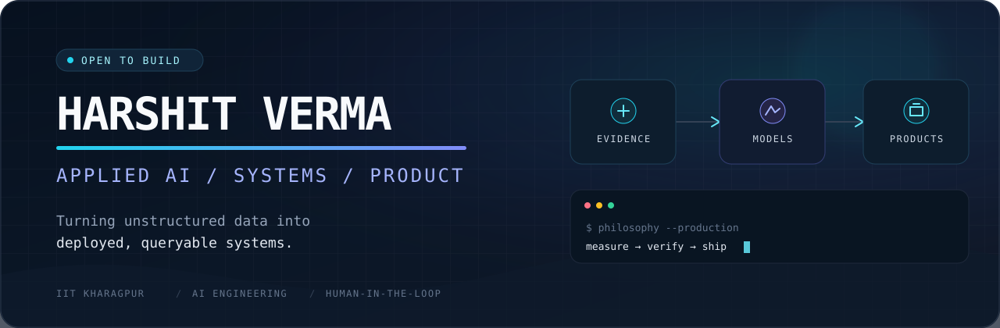

<div align="center">
  <a href="https://harshit-verma-brown.vercel.app">
    
  </a>
</div>

<div align="center">
  <br />
  <a href="https://harshit-verma-brown.vercel.app"></a>
  <a href="https://www.linkedin.com/in/harshit-verma-40183528a/"></a>
  <a href="https://github.com/whyharshit?tab=repositories"></a>
</div>

## I turn unstructured data into deployed, queryable systems.

I'm **Harshit Verma**, an architecture student at IIT Kharagpur who took the long way into AI engineering—and kept the systems thinking. I build end-to-end ML and LLM products: data acquisition, evaluation, APIs, agents, and the interface people actually use.

```text
messy input  ->  structured evidence  ->  measured model  ->  useful product
```

- Building AI agent operations at **Omnidel.ai**
- Co-building **Quiet**, a privacy-first, on-device AI note-taker for confidential work
- Interested in trustworthy agents, applied ML, and systems that survive outside a notebook

## Selected work

| Project | What it proves | Stack |
| :-- | :-- | :-- |
| **[Warrant](https://github.com/whyharshit/intent-shield)** | Defence-first intent conformance for agent purchases. The measured baseline catches only **16.8%** of violations; Warrant is being built to close the gap with deterministic checks, semantic verification, and calibrated escalation. | Python · evaluation · agent safety |
| **[DigitalTwin.ai](https://github.com/whyharshit/digitaltwin-ai-bosch)** | Predicts the station that will constrain a vehicle assembly line **2–5 minutes ahead**. Built on 1.18M Bosch production records and designed to work without a sensor retrofit. | Python · ML · SHAP · simulation |
| **[Meet → Trello Agent](https://github.com/whyharshit/AI_agent_google_meet)** | Turns Hindi, English, and Hinglish stand-ups into Trello actions, with Telegram approval before every write. Serverless, traceable, and human-in-the-loop. | TypeScript · Gemini · Supabase · Vercel |
| **[Rate Watch](https://github.com/whyharshit/Nuel_Assignment)** | A resilient crypto data pipeline with append-only SQLite history, two-provider fallback, derived metrics, FastAPI, and **33 offline tests**. | Python · FastAPI · SQLite · testing |
| **[OmniTrack](https://github.com/whyharshit/OmniTrack)** | Multi-tenant FinOps monitoring across AI and cloud providers, with health scoring, forecasts, alerts, reports, audit logs, and RBAC. | Next.js · TypeScript · Supabase |
| **[Portfolio + JARVIS](https://github.com/whyharshit/Harshit_Verma)** | A bilingual, voice-enabled portfolio assistant grounded in the same project notes the site renders—one source of truth for both interface and AI. | Next.js · Gemini · streaming TTS |

## Tools I reach for

<p>
  
  
  
  
  
  
  
  
</p>

`ML / AI` &nbsp; LLMs · RAG · agent workflows · NLP · evaluation · scikit-learn · TensorFlow  
`Data` &nbsp;&nbsp;&nbsp;&nbsp;&nbsp; Pandas · NumPy · SQL · pgvector · ChromaDB · Dask  
`Product` &nbsp;&nbsp; FastAPI · Next.js · Streamlit · Supabase · Vercel · Docker

## How I build

> **Measure the baseline. Keep the evidence. Put a human at the irreversible edge.**

I like systems with explicit failure modes, honest metrics, and a useful interface. If a model is uncertain, the product should know what to do next.

<div align="center">
  <sub>B.Arch @ IIT Kharagpur · AI engineering by way of architecture, systems thinking, and a lot of shipped code.</sub>
</div>
