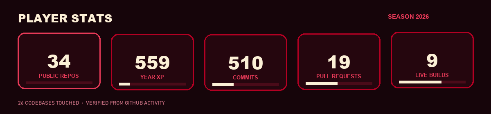
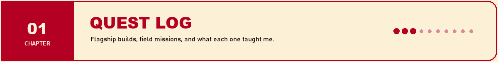
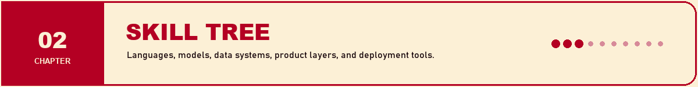
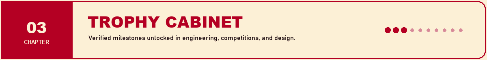

<p align="center">
  
</p>

<p align="center">
  <strong>ARCHITECTURE-TRAINED AI ENGINEER · PIPELINE BUILDER · PRODUCT PERSON</strong><br />
  <sub>I take unstructured documents, conversations, images, and operational noise—and turn them into systems people can actually use.</sub>
</p>

<p align="center">
  <a href="https://harshit-verma-brown.vercel.app"></a>
  <a href="https://www.linkedin.com/in/harshit-verma-40183528a/"></a>
  <a href="https://harshit-verma-brown.vercel.app/Harshit_Verma_CV.pdf"></a>
</p>

<p align="center">
  
  
  
</p>



<sub>Stats are a verified GitHub snapshot from 16 October 2026. Private work is described only where results are documented.</sub>

<br />



## 🟥 BOSS QUESTS — systems with teeth

### 01 · Warrant — intent conformance for agent purchases

  [](https://github.com/whyharshit/intent-shield)

An AI agent can present a perfectly signed purchase mandate and still violate what the customer meant. Warrant checks the missing layer: category, attributes, substitutions, quantity, timing, frequency, and add-on creep. The reference amount-and-merchant baseline catches just **16.8% of labelled violations** on 3,126 train/validation pairs.

`Python` `typed constraints` `semantic verification` `cost-aware escalation` `99 tests`

> 🎯 **KEY TAKEAWAY** — Cryptographic authorization proves a document is authentic; it does not prove the cart honours intent. Trustworthy agents need deterministic checks, calibrated uncertainty, and an explicit `ESCALATE` path.

---

### 02 · DigitalTwin.ai — predict the assembly-line constraint before it moves

  [](https://github.com/whyharshit/digitaltwin-ai-bosch)

A working digital twin built on the Bosch Production Line Performance dataset. It predicts which station will constrain throughput at **2-minute and 5-minute horizons**, ranks defect risk, names likely root-cause stations, and attaches TreeSHAP evidence to every alert.

`64.1% @ 2 min` `58.5% @ 5 min` `95.1% alert-time root cause` `Python` `SHAP`

> 🎯 **KEY TAKEAWAY** — Deployment wins when the model starts with signals the factory already emits. The primary predictor retains **99.9%** of its accuracy without sensor features, so better instrumentation becomes an incremental business case instead of a prerequisite.

---

### 03 · Quiet — privacy-first AI for confidential conversations

 

A fully on-device note-taking layer for therapists and lawyers using WhisperKit and Ollama. Nothing leaves the machine. The product direction came from **40+ customer interviews** and now has **three paying pilot users at $19/month**.

`WhisperKit` `Ollama` `on-device inference` `customer discovery` `privacy by architecture`

> 🎯 **KEY TAKEAWAY** — Privacy is not a compliance paragraph added at the end. For high-trust professions, the data boundary is the product—and the reason someone will pay for it.

---

### 04 · Meet → Trello agent — conversations become approved actions

  [](https://github.com/whyharshit/AI_agent_google_meet)

Processes Hindi, English, and Hinglish stand-ups, extracts structured tasks, fuzzy-matches them to Trello cards, and asks an authorised human to approve each change through Telegram. The production workflow has processed **250+ transcripts** and captured **170 of 179 discussed tasks**.

`TypeScript` `Gemini` `Fireflies` `Telegram` `Trello` `Supabase` `Vercel`

> 🎯 **KEY TAKEAWAY** — Human approval is not friction to remove; it is the safe transaction boundary. The agent does the tedious interpretation, while the accountable human keeps the irreversible write.

## 🟨 FIELD MISSIONS — production data, retrieval, and decision systems

### 05 · ESG intelligence pipeline — filings into measurable climate signals

 

An internship system that acquires Indian BRSR filings and annual reports, runs OCR and schema-constrained extraction, engineers **35+ ESG predictors**, and predicts Scope 1 and Scope 2 emissions. The resulting dashboard covers **2,000+ firms across 40+ sectors**.

`Python` `Selenium` `OCR` `LLMs` `JSON Schema` `HistGradientBoosting`

> 🎯 **KEY TAKEAWAY** — On messy enterprise documents, the modelling work starts only after provenance, schema validation, and extraction quality are under control. Reliable structure is the real feature engineering.

---

### 06 · UnoJobs matching — 1M+ applicants to a shortlist of 10–15

 

A three-stage retrieval system combining SQL hard filters, 1,536-dimensional vector search, skill-graph matching, and an LLM reranker. It narrows the search space to a top 50 before producing a curated recruiter shortlist.

`Python` `SQL` `Supabase` `pgvector` `embeddings` `LLM reranking`

> 🎯 **KEY TAKEAWAY** — Large-scale matching is a funnel, not a prompt. Cheap deterministic filters protect recall and cost; semantic retrieval finds candidates; the LLM only spends tokens on the final judgement.

---

### 07 · Rate Watch — resilient crypto market data pipeline

  [](https://nuelassignmentharshitverma.vercel.app) [](https://github.com/whyharshit/Nuel_Assignment)

A pull → store → compute → serve pipeline for BTC, ETH, and SOL with timestamped SQLite snapshots, two-provider fallback, derived metrics, pipeline-health reporting, and a dependency-light dashboard.

`Python` `FastAPI` `SQLite WAL` `pure metric functions` `failure observability`

> 🎯 **KEY TAKEAWAY** — Failed pulls are data too. Recording them beside successful observations lets the product distinguish “nothing changed” from “the upstream failed,” which is the difference between a chart and an operable system.

---

### 08 · OmniTrack — FinOps command centre for AI infrastructure

  [](https://omni-track-eta.vercel.app) [](https://github.com/whyharshit/OmniTrack)

Tracks balances, spend, usage, forecasts, alerts, invoices, and infrastructure health across AI and cloud providers. Includes RBAC, row-level security, audit logs, scheduled reports, and multi-channel notifications.

`Next.js 15` `React 19` `TypeScript` `Supabase` `Recharts` `Resend` `Slack`

> 🎯 **KEY TAKEAWAY** — A unified dashboard is only useful when it normalises unlike provider concepts without erasing their differences. The product needs a shared operating model, not just ten API integrations.

---

### 09 · Portfolio + JARVIS — one source of truth for page and assistant

  [](https://harshit-verma-brown.vercel.app) [](https://github.com/whyharshit/Harshit_Verma)

An interactive portfolio and bilingual voice assistant driven by the same versioned project files. Responses stream sentence-by-sentence into an ordered audio queue, with waveform-driven visuals and provider fallbacks.

`Next.js` `Gemini` `streaming TTS` `Hindi + English` `shared content graph`

> 🎯 **KEY TAKEAWAY** — An AI interface becomes easier to trust when the page and the model read the same facts. One source of truth prevents the polished UI and the conversational layer from quietly disagreeing.

## ⬛ LAB RUNS — models, experiments, and competition builds

### 10 · Dental caries segmentation

**Mission:** Segment tiny lesions on panoramic X-rays with a U-Net/ResNet34 model; frozen test result: **0.674 Dice**, **0.680 precision**, **0.667 recall**. [Open repository →](https://github.com/whyharshit/dental-caries-segmentation)

> 🎯 **KEY TAKEAWAY** — The aggregate score hid the useful result: deep lesions reached 0.705 Dice while superficial ones reached 0.070. Severity-stratified evaluation exposed the clinical failure mode that the next iteration must target.

### 11 · Swiggy delivery-time MLOps

**Mission:** Take delivery-time regression from notebook to service: **3.13-minute MAE**, **0.83 R²**, 45,000+ orders, FastAPI, DVC, MLflow, Docker, and CI.

> 🎯 **KEY TAKEAWAY** — A good validation score is the beginning of production work. Reproducible data, tracked experiments, serving parity, and automated checks are what turn the model into a system.

### 12 · Spotify hybrid recommendation engine

**Mission:** Blend content and collaborative signals across **9K+ users and 30K songs**, handling a 30K × 962K interaction space with Dask and SciPy sparse matrices.

> 🎯 **KEY TAKEAWAY** — Hybrid recommendation balances similarity with discovery, while sparse representation makes a seemingly impossible interaction matrix computationally ordinary.

### 13 · YouTube transcript RAG

**Mission:** Semantic Q&A over 1,000+ transcript lines with LangChain, Gemini, ChromaDB, recursive chunking, Streamlit, and **sub-3-second response latency**.

> 🎯 **KEY TAKEAWAY** — Retrieval quality is usually decided before generation. Chunk boundaries and evidence selection matter more than making the final prompt theatrical.

### 14 · CityScape — IIM Lucknow urban mobility challenge

**Mission:** First runner-up among **2,000+ participants** for a multimodal mobility framework combining YOLOv8 traffic monitoring, ALPR, and density-adaptive signal optimisation.

> 🎯 **KEY TAKEAWAY** — Computer vision earns its place when detections feed an operational decision. Counting vehicles is a demo; adapting traffic policy is the system.

### 15 · The side-quest arcade

| Build | What it explores | Key takeaway |
| :-- | :-- | :-- |
| **[PM Hunt Agent](https://github.com/whyharshit/pm-hunt-agent)** | Personal AI/ML opportunity discovery and outreach | Agent value comes from closing a workflow loop, not producing another recommendation list. |
| **[Vajra Acharya](https://github.com/whyharshit/Vajra-Acharya)** | AI-assisted service workflow with a deployed interface | Domain tools win when the AI disappears behind a clear job-to-be-done. |
| **[Electrician Acharya](https://github.com/whyharshit/ElectricianAcharya)** | A focused field-service product | Narrow scope creates a sharper product than a general-purpose assistant. |
| **[PDF Quotation Generator](https://github.com/whyharshit/-PDF-Generator-Quotation)** | Structured quotation-to-document automation | Boring automation is powerful when it removes repeated, error-prone formatting. |
| **[DSA LeetCode](https://github.com/whyharshit/DSAleetcode)** | C++ problem-solving practice | Strong systems intuition still rests on data structures, constraints, and complexity. |
| **[RAG Agentic Projects](https://github.com/whyharshit/RAG_BASED_AGENTIC_PROJECTS)** | Resume analysis and early RAG experiments | Every polished agent begins as a small experiment whose limitations are made visible. |

<br />



## Languages


## AI / ML

`machine learning` · `deep learning` · `NLP` · `LLMs` · `RAG` · `agent workflows` · `computer vision` · `evaluation` · `calibration` · `embeddings` · `SHAP`


## Data / retrieval

`Pandas` · `NumPy` · `Dask` · `SciPy` · `MySQL` · `Postgres` · `Supabase` · `pgvector` · `ChromaDB` · `SQLite` · `OCR` · `Selenium`

## Product / systems

`FastAPI` · `Next.js` · `React` · `Streamlit` · `Docker` · `Vercel` · `GitHub Actions` · `MLflow` · `DVC` · `Telegram Bot API` · `Trello API` · `Power BI` · `Tableau`

### Skill-tree loadout

| Branch | Core ability | Where it shows up |
| :-- | :-- | :-- |
| **Evidence engineering** | Acquire, validate, structure, and preserve provenance | ESG pipeline · Warrant · Rate Watch |
| **Model engineering** | Baselines, leakage checks, calibration, and failure analysis | DigitalTwin.ai · dental segmentation · Swiggy |
| **Retrieval systems** | Filter → embed → rank → explain | UnoJobs · YouTube RAG · portfolio JARVIS |
| **Agent operations** | Tool use, approvals, retries, and auditable writes | Meet → Trello · Warrant · PM Hunt Agent |
| **Product delivery** | APIs, interfaces, deployments, monitoring, and feedback loops | OmniTrack · Quiet · nine live builds |

<br />



## 🏆 Unlocked

| Achievement | Unlock condition |
| :-- | :-- |
| 🥈 **CityScape First Runner-Up** | Placed first runner-up among **2,000+ participants** in IIM Lucknow's urban mobility case competition. |
| 🏅 **D24 Gold × 2** | Won gold twice at the inter-college 24-hour architecture design challenge run by IIT Kharagpur, Jadavpur University, and IIEST Shibpur. |
| 🎙️ **Open IIT Hindi Elocution — 1st** | Won first place against **50+ participants**. |
| 🚀 **From research to revenue** | Turned 40+ discovery interviews into **three paying Quiet pilot users**. |
| 🧠 **Production AI internship arc** | Shipped work across Fitsol, UnoJobs, and Omnidel.ai: document intelligence, candidate retrieval, and agent operations. |
| 🎨 **Design & Media Head — Kshitij** | Led branding and media operations for IIT Kharagpur's annual techno-management festival. |
| 🪔 **Illumination 2025 — 3rd place team** | Contributed to JCB Hall's 5,000+ lamp installation and third-place finish. |
| 🔥 **2026 GitHub streak** | Logged **559 contributions**, including **510 commits** and **19 pull requests** in the current contribution year snapshot. |

## 🎮 Current party

```text
Harshit / AI systems builder
├── Omnidel.ai ........ AI Agent Operations Intern
├── Quiet ............. Co-founder, private on-device AI
├── IIT Kharagpur ..... B.Arch '28
└── next unlock ....... trustworthy agents that survive contact with reality
```

<p align="center">
  <a href="https://harshit-verma-brown.vercel.app"><strong>PLAY THE INTERACTIVE PORTFOLIO</strong></a>
  &nbsp;·&nbsp;
  <a href="https://www.linkedin.com/in/harshit-verma-40183528a/"><strong>CONNECT ON LINKEDIN</strong></a>
  &nbsp;·&nbsp;
  <a href="https://github.com/whyharshit?tab=repositories"><strong>EXPLORE ALL REPOSITORIES</strong></a>
</p>


