

  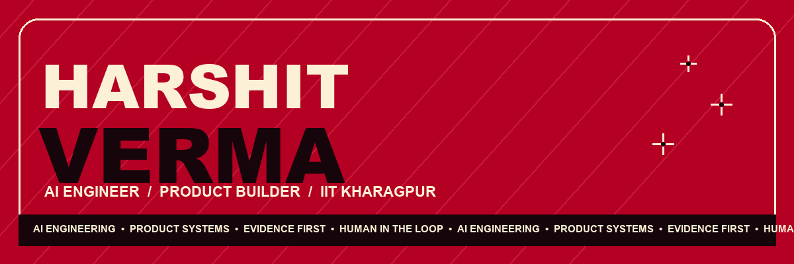

  
  
  

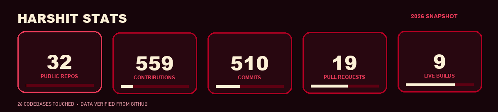

## Selected builds

<a href="https://github.com/whyharshit/intent-shield">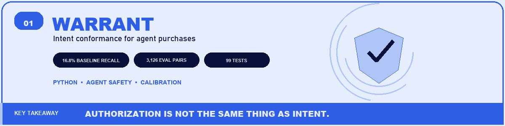</a>

<a href="https://github.com/whyharshit/digitaltwin-ai-bosch">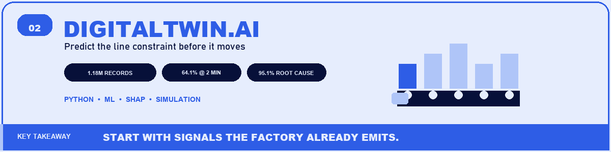</a>

<a href="https://github.com/whyharshit/AI_agent_google_meet">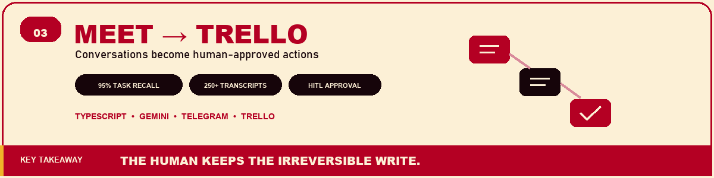</a>

<a href="https://github.com/whyharshit/Nuel_Assignment">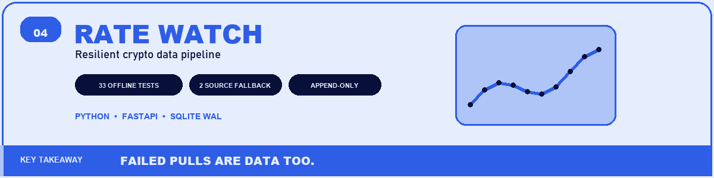</a>

<a href="https://github.com/whyharshit/OmniTrack">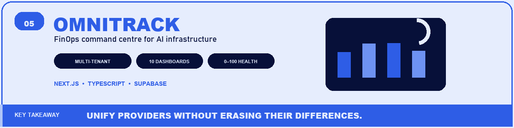</a>

<a href="https://github.com/whyharshit/Harshit_Verma">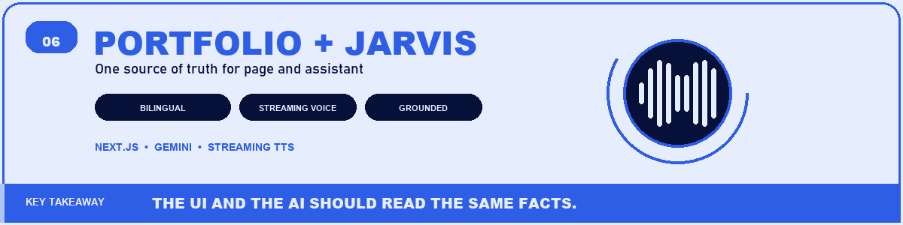</a>

## Stack

  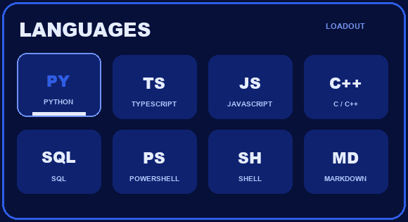
  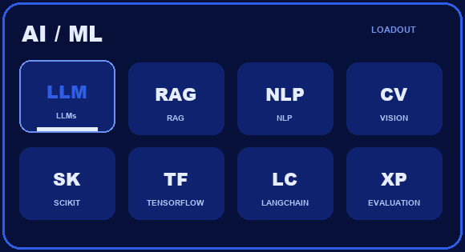

  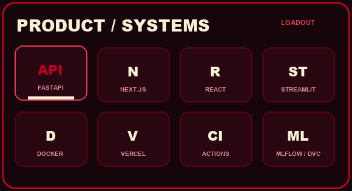
  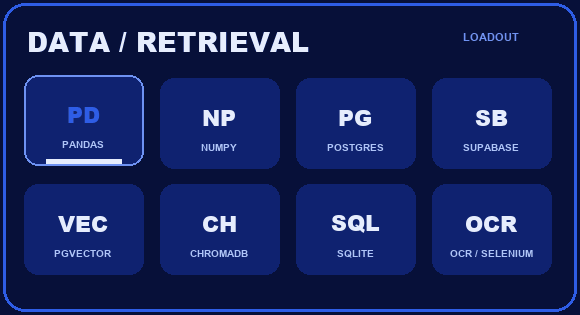

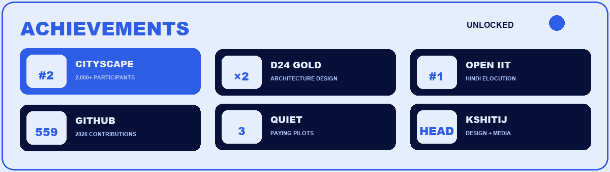

  <a href="https://harshit-verma-brown.vercel.app"><strong>PORTFOLIO</strong></a>
  &nbsp;&nbsp;·&nbsp;&nbsp;
  <a href="https://www.linkedin.com/in/harshit-verma-40183528a/"><strong>LINKEDIN</strong></a>
  &nbsp;&nbsp;·&nbsp;&nbsp;
  <a href="https://github.com/whyharshit?tab=repositories"><strong>ALL REPOSITORIES</strong></a>

